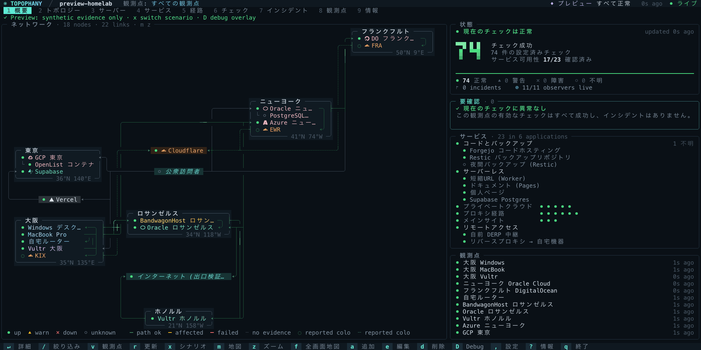
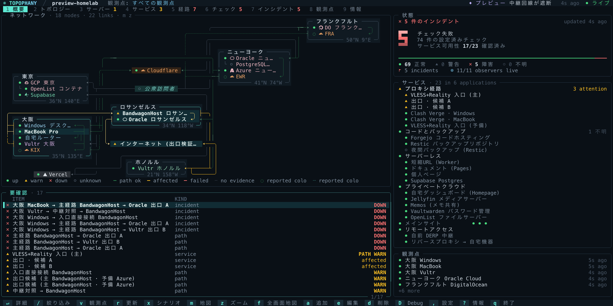
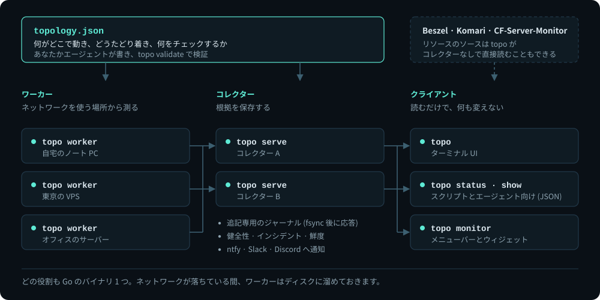
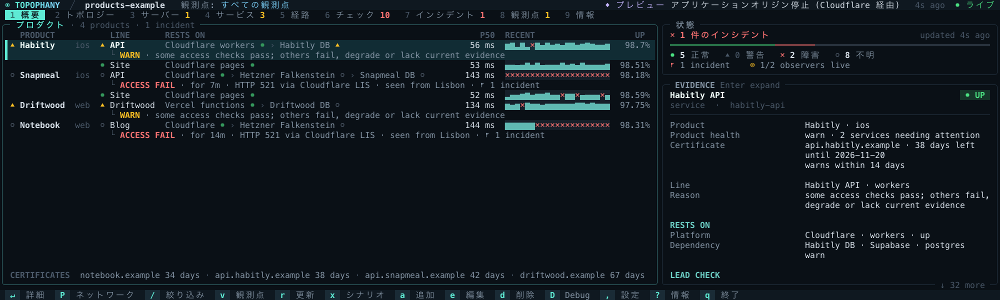
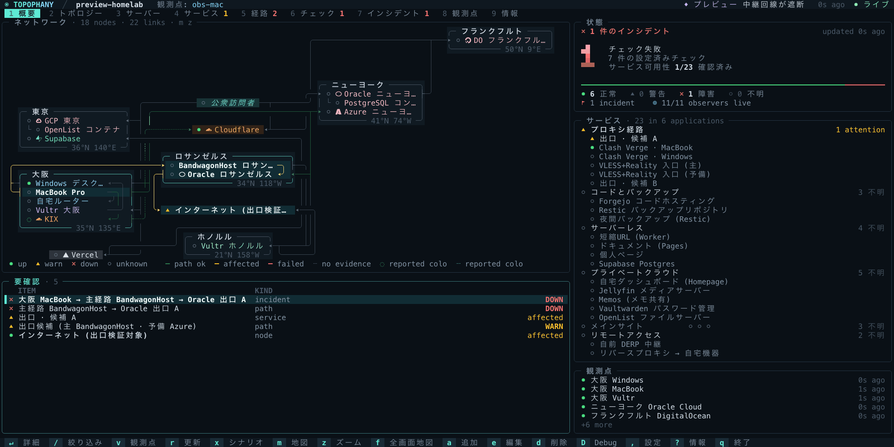

<h1 align="center">
  
</h1>

<p align="center"><b>どこから、どの経路で、何に届いたのか — そして、何を根拠に。</b></p>

<p align="center">
  <a href="https://topophany.com/ja/demo/"></a>
</p>

<p align="center">
  <a href="https://topophany.com/ja/"><b>topophany.com</b></a> ·
  <a href="https://github.com/WhitenWhiten/topophany/releases">ダウンロード</a> ·
  <a href="docs/GUIDE.md">ユーザーガイド (英語)</a>
</p>

<p align="center"><sub><a href="README.md">English</a> · <b>日本語</b> · <a href="README.zh.md">简体中文</a></sub></p>

<p align="center">
  <a href="https://github.com/WhitenWhiten/topophany/actions/workflows/ci.yml"></a>
  <a href="https://pkg.go.dev/github.com/WhitenWhiten/topophany"></a>
  <a href="LICENSE"></a>
  <a href="https://linux.do"></a>
</p>

**Topophany** は、ネットワーク全体をひとつの画面に描き出します。どのマシンがどこにあり、互いがどの経路でつながり、その上でどんなサービスが動いているのか。ワーカーはあなたが実際にネットワークを使う場所からチェックを行い、ターミナル UI は、何が壊れているのか、それがどこから見えたのか、そして何を根拠にそう言えるのかを示します。すべてはセルフホストできる Go のバイナリ 1 つ、`topo` に収まっています。

<p align="center">
  
  <br><sub><code>topo preview --lang ja</code> で <code>x</code> を押すと障害が起きます。問題を選ぶとその経路が浮かび上がり、<code>Enter</code> で根拠が開きます。</sub>
</p>

## 主な機能

- **壊れたことだけでなく、どこで壊れたのかを。** チェックはすべて、名前を付けた観測点から行います。大阪からは届かないのにニューヨークからは届くなら、それはサーバーダウンではなく、大阪からの経路の障害です。
- **色ではなく根拠を。** 健全性、根拠の出どころ、鮮度はそれぞれ別に扱います。成功したチェックがなければ緑にはならず、誰もチェックしていないサービスは `unknown` のままです。
- **ネットワークをファイル 1 つに。** 何がどこで動き、各マシンにどうたどり着き、何をチェックするのか。レビュー済みの JSON のトポロジーに、メモと一緒にまとまります。コーディングエージェントに書かせることもでき、`topo validate` で検証します。
- **通信が通る道のままにチェック。** HTTP、TLS、TCP、DNS (DoT・DoH を含む)、SSH、UDP、ICMP、ホストのリソースを、複数段のプロキシチェーン越しにも。読み取り専用のアダプターで Mihomo、Tailscale、WireGuard、cloudflared、Cloudflare API、Beszel、Komari、CF-Server-Monitor を読みます。Cloudflare、Vercel、Supabase などのエッジからの応答を、その後ろのオリジンの応答と取り違えることはありません。
- **眺めていたくなる画面。** 点字で描く世界地図、模式図、ネットワークグラフ、サーバーとサービスごとのカード。どのターミナルでも動き、マウスも使えます。
- **プロダクトモード。** アプリやサイトを運営する人のために、ユーザーが触れる部分ごとに 1 行、それが載っているものすべてと一緒に並べます。
- **スクリプトやエージェントからも。** `topo status`、`topo show`、`topo history` が 1 行か JSON で答え、`topo monitor` はメニューバーやデスクトップウィジェットに状態を届けます。
- **バイナリ 1 つ、ほかには何も要らない。** CGO も、データベースのデーモンも、Node.js も不要で、外部の Go モジュールにも一切依存しません。

<p align="center">
  
  <br><sub>障害をシミュレートしている Overview。<code>topo preview --lang ja --scenario 1</code> より。</sub>
</p>

## すぐに試す

[リリースページ](https://github.com/WhitenWhiten/topophany/releases) (Linux、macOS、Windows · amd64、arm64) からダウンロードするか、Go 1.26.11 以降でインストールします。

```sh
go install github.com/WhitenWhiten/topophany/cmd/topo@latest
```

何も準備しなくても、合成データで UI 全体を試せます。`x` を押せば障害を起こせます。

```sh
topo preview
```

自分のネットワークを監視するには、[ユーザーガイド](docs/GUIDE.md) (英語) に沿って、[`examples/`](examples/) のトポロジーから始めてください。設定項目はすべて[リファレンス](docs/REFERENCE.md) (英語) にあります。アップグレードする場合は [1.7.0 のリリースノート](docs/releases/v1.7.0.md) (英語) を読んでください。

## しくみ

<p align="center">
  
</p>

ワーカーがチェックを行い、見たものを 1 つか 2 つのコレクターに届けます。コレクターは追記専用のジャーナルを持ち、健全性、インシデント、鮮度を判断します。クライアントは読むだけです。TUI を閉じても監視は止まらず、Topophany がルート、プロキシ、サービスを変更することはありません。

## プロダクトモード

<p align="center">
  
  <br><sub>Cloudflare の後ろのサーバーが応答しなくなった状態。<code>topo preview --config examples/products.json --mode products --scenario 2</code> より。</sub>
</p>

`P` を押すと Overview がボードに変わります。プロダクトの各部分が 1 行ずつ並び、エッジからデータベースまで何の上に載っているか、遅延、最近のサンプル、稼働率を示します。問題のある部分には、何が、いつから、どこから見て失敗しているかが添えられます。ボードのマークはどれもネットワークビューと同じです。[プロダクトモードのガイド](docs/PRODUCTS.md) (英語)

## ターミナル UI

<p align="center">
  
  <br><sub>大阪からはダウン、ニューヨークからは正常。各観測点は自分に見えるものだけを報告します (<code>v</code>)。続いて 3 種類のマップ (<code>m</code>)。</sub>
</p>

Overview から Incidents まで 9 つのタブがあり、サービスは属するアプリケーションごとに、チェックは検証するサービスごとにまとまります。すべてのタブ、マップ、キーは[ユーザーガイド](docs/GUIDE.md) (英語) で説明しています。

## macOS のメニューバーで

<p align="center">
  <a href="https://github.com/WhitenWhiten/topophany-bar"></a>
</p>

[**topophany-bar**](https://github.com/WhitenWhiten/topophany-bar) は Topophany の macOS 用コンパニオンです。状態をメニューバーに、各問題がどこから見えているかをパネルに、サーバー、サービス、地図、タイムゾーンをデスクトップのウィジェットに表示します。現在はプレリリースで、macOS 26 以降が必要です。

## ドキュメント

ドキュメントは英語のみです (中国語のタスク別ガイドを除く)。

| | |
|---|---|
| [ユーザーガイド](docs/GUIDE.md) · [中国語ガイド](docs/GUIDE.zh.md) | 導入、TUI、プレビューモード、プローブ、複数拠点での運用 |
| [設定と API のリファレンス](docs/REFERENCE.md) | すべてのエンティティ、プローブのパラメーター、API エンドポイント |
| [プロダクトモード](docs/PRODUCTS.md) | アプリやサイトを出す人のための Overview |
| [Cloudflare](docs/CLOUDFLARE.md) · [直接接続モード](docs/DIRECT.md) | エッジからオリジンまで。コレクターなしで読むリソースのソース |
| [運用](docs/OPERATIONS.md) · [メモリ](docs/MEMORY.md) | デュアルコレクター、systemd ユニット、ストレージ、復旧、メモリ予算 |
| [セキュリティモデル](docs/SECURITY.md) · [リモート管理](docs/MANAGEMENT.md) | 認証情報、通信、オプトインの設定配信と更新 |
| [シナリオ](docs/SCENARIOS.md) · [受け入れ](docs/ACCEPTANCE.md) | テストで証明できること、実機で確かめる必要があること |
| [サンプル](examples/) | 出発点になるトポロジーの例 |
| [変更履歴](CHANGELOG.md) · [リリースノート](docs/releases/) | リリースの履歴とアップグレードの注意 |

## 開発

```sh
go test ./...                # unit and integration tests
python3 scripts/verify.py    # the full acceptance suite (Linux, Go, Python 3)
make captures architecture   # redraw the README's TUI captures and diagram
```

変更を送る前に [CONTRIBUTING.md](CONTRIBUTING.md) と[行動規範](CODE_OF_CONDUCT.md)を読んでください。脆弱性は [SECURITY.md](SECURITY.md) の手順に従って非公開で報告してください。

## ライセンス

[MIT](LICENSE)
