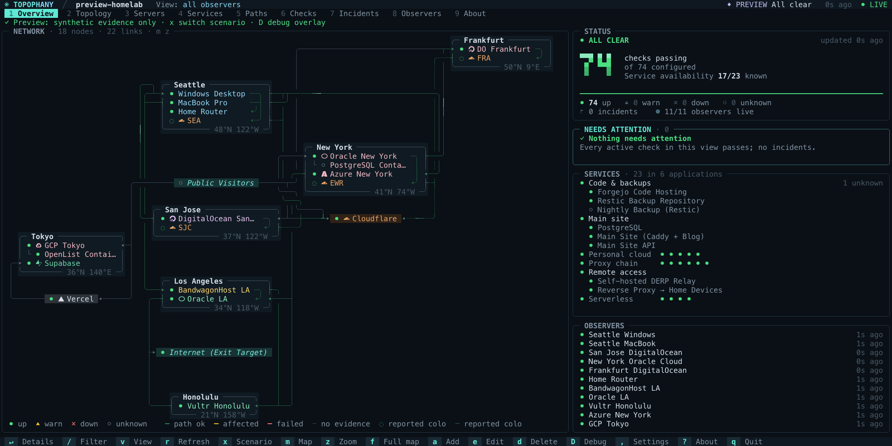
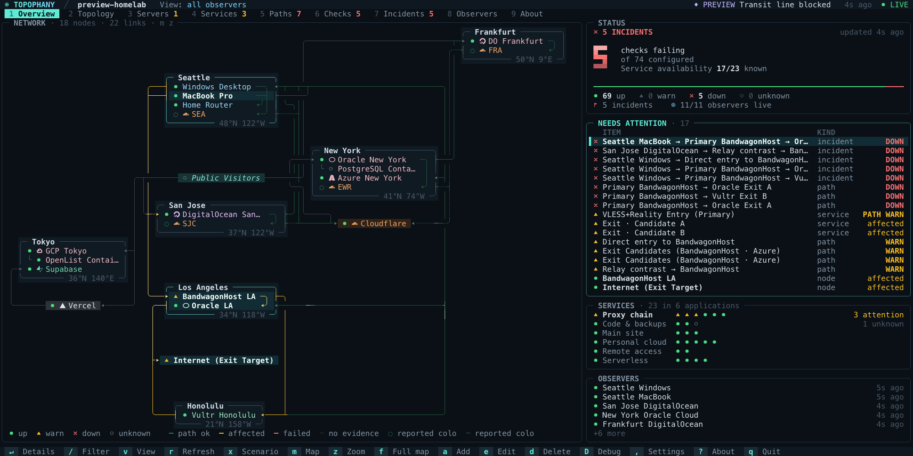
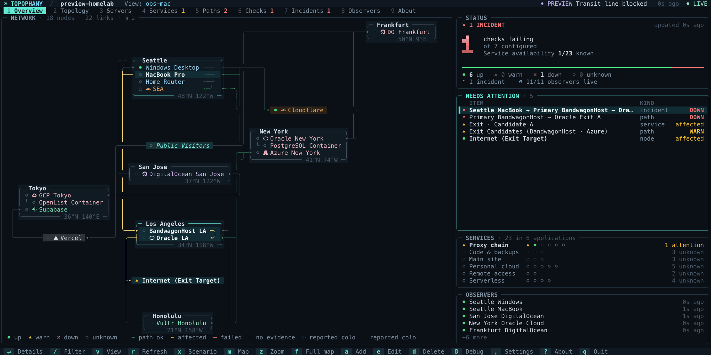

<h1 align="center">
  
</h1>

<p align="center"><b>From where, via which path, reaching what — and on what evidence.</b></p>

<p align="center">
  <a href="https://topophany.com/demo/"></a>
</p>

<p align="center">
  <a href="https://topophany.com"><b>topophany.com</b></a> ·
  <a href="https://github.com/WhitenWhiten/topophany/releases">Download</a> ·
  <a href="docs/GUIDE.md">User guide</a>
</p>

<p align="center"><sub><b>English</b> · <a href="README.ja.md">日本語</a> · <a href="README.zh.md">简体中文</a></sub></p>

<p align="center">
  <a href="https://github.com/WhitenWhiten/topophany/actions/workflows/ci.yml"></a>
  <a href="https://pkg.go.dev/github.com/WhitenWhiten/topophany"></a>
  <a href="LICENSE"></a>
  <a href="https://linux.do"></a>
</p>

**Topophany** puts your network on one screen: your machines and where they are, the paths between them and the services they run. Workers check it from the places you actually connect from (home, the office, a VPS abroad), and the terminal UI shows what is broken, seen from where, and the evidence for it. All of it is one self-hosted Go binary, `topo`.

<p align="center">
  
  <br><sub>Press <code>x</code> in <code>topo preview --lang en</code> and home loses the line to the transit host in Los Angeles. Select a problem and its route lights up; <code>Enter</code> shows the evidence. Then the geo map takes the whole screen (<code>f</code>) and trades its place cards for points (<code>p</code>).</sub>
</p>

## Why Topophany

- **Where it breaks, not just that it broke.** Every check runs from a vantage point you name. Down from Seattle but fine from New York is a fault on Seattle's path, and Topophany reports it as one instead of calling the server down.
- **Evidence, not colors.** Health, where the evidence came from and how fresh it is are separate fields. Nothing turns green without a passing check, a service nobody checks stays `unknown`, and a cached view says it is cached.
- **A memo of your network.** One reviewed JSON file says what runs where, how each machine is reached and which chain each path takes, with your notes and runbooks beside them. You read it, your agent reads it, and the monitor checks against it.
- **Made to be looked at.** A braille world map that puts the Cloudflare colo a check answered from at its place, a schematic map that keeps places in order, a network graph, a card for every server and services folded into the applications they serve, in any terminal, mouse included.
- **One binary, nothing else.** No CGO, no database daemon, no Node.js, and zero external Go modules.

<p align="center">
  
  <br><sub>The Overview during a simulated outage, from <code>topo preview --lang en --scenario 1</code>.</sub>
</p>

## Try it in a minute

Download a build from the [releases page](https://github.com/WhitenWhiten/topophany/releases) (Linux, macOS, Windows · amd64, arm64), or install it with Go 1.26.11 or newer:

```sh
go install github.com/WhitenWhiten/topophany/cmd/topo@latest
```

To see the whole UI with nothing to set up, run it on synthetic evidence and press `x` to break something. The built-in network and its scenarios come in English, Japanese and Chinese and follow your locale; `--lang ja` picks one:

```sh
topo preview
```

Or run a real collector on this machine, with a demo topology and fresh credentials:

```sh
topo init --dir ./demo
topo serve --config ./demo/topology.json --auth ./demo/auth.json \
  --data ./demo/collector-data --observer demo

# in another terminal
topo --credentials ./demo/credentials.json
```

## Let your agent write it

The slow part of any monitor is describing what to monitor, and that is work a coding agent does well. Ask the one you use (Claude Code, Codex, Gemini CLI, Cursor or any other that can run commands) to read what your machines already say about themselves and write the topology. It checks its own work with `topo validate`, and you look the result over in `topo preview` before anything runs. A prompt to start from:

> Write a Topophany topology of my network to `topology.json`. Learn the format from `topo preview --print-topology` and docs/REFERENCE.md in github.com/WhitenWhiten/topophany. Read my SSH config, `tailscale status`, and the Compose files and reverse-proxy configs you can find. Declare each machine with where it is, the services on it, the applications they belong to and the addresses they answer on, add checks from the machines I will run workers on, and write what you learn about each machine into its notes. Never put a secret in the file. Run `topo validate --config topology.json` until it passes, then tell me what you found and what you guessed.

Once it is written, it keeps working for both of you:

- **A memo of your network.** The file says what runs where and how each machine is reached, with notes and runbooks beside them. Your agent reads it before touching anything, and you review its edits as a diff, like code; `topo edit` changes it in a TUI.
- **A quick interface.** `topo status`, `topo show` and `topo history` answer in a line, or in JSON with `--json`: is anything wrong, what runs on that server, how a check fared overnight. Before any collector runs, `topo preview --config topology.json show servers` answers from the file alone.

## How it works

```text
  WORKERS                          COLLECTORS                  CLIENTS
  measure from where they are      keep the evidence           read it

  topo worker   (home laptop)  ─┬─▶  topo serve  (A)  ─┬─▶  topo          the TUI
  topo worker   (Tokyo server) ─┴─▶  topo serve  (B)  ─┴─▶  topo status   for scripts and agents
```

- **Workers** run the checks in a reviewed local topology file and deliver what they observe to one or two collectors, buffering on disk while the network is down.
- **Collectors** keep an append-only journal (fsync before acknowledging) and work out health, incidents and freshness. They remember each incident from opening to close and how each check fared for months, can post incidents to webhooks (ntfy, Slack, Discord or JSON), and can run checks of their own.
- **Clients** only read. Closing the TUI does not stop monitoring, and nothing in Topophany changes routes, proxies or services.

| Command | What it does |
|---|---|
| `topo` | Open the TUI on a remote collector, using saved credentials |
| `topo status` / `topo show TAB [ID]` | Print what the TUI shows, as text or `--json`; `status` answers in its exit status too |
| `topo login` | Save and verify a connection to a collector |
| `topo serve` | Run a collector, optionally with checks of its own |
| `topo worker` | Run checks from this machine and report them |
| `topo edit` / `topo validate` | Edit a topology file in a TUI / check it and print its revision and contracts |
| `topo preview` | Open the TUI on synthetic evidence |
| `topo monitor` | Feed the status to desktop widgets and menu bars such as [topophany-bar](https://github.com/WhitenWhiten/topophany-bar), as a file or an NDJSON stream |
| `topo init` | Create a local demo with fresh credentials |

Run `topo help` for the full list.

## Monitor your own network

1. **Describe it.** A topology in JSON lists nodes, links, endpoints, services, paths, observers and checks. Have your agent write it as above, or start from [`examples/homelab.json`](examples/homelab.json) and edit it with `topo edit --config topology.json`. Either way, `topo validate` checks it. For a Cloudflare zone, [`examples/cloudflare.json`](examples/cloudflare.json) is a worked topology: a proxied origin with its own direct check, a Worker and a Pages site, a Tunnel with a `cloudflared` check beside a loopback check of the service, trace and DoT checks, and a hostname behind Access. `topo preview` simulates a challenge page, answers from a colo outside the declared list, and a Tunnel connector going down, so you can see how each is judged before anything runs.
2. **Run a collector** where your devices can reach it, with TLS: `topo serve --config topology.json --auth auth.json --data collector-data --listen 0.0.0.0:7447 --tls-cert server.pem --tls-key server-key.pem`
3. **Run a worker** on every machine you want to measure from: `topo worker --config topology.json --observer <id> --credentials worker-credentials.json --data worker-data`
4. **Look at it** from anywhere: `topo login --server https://your-collector:7447 --project <name>`, then just `topo`.

The [operations guide](docs/OPERATIONS.md) covers dual collectors, systemd units and limits, [memory budgets](docs/MEMORY.md) cover sizing a small machine, and the [security model](docs/SECURITY.md) covers tokens and transport.

### Upgrading

- **Upgrade collectors first for 1.6.0 resource readings.** A 1.6.0 worker adds network, swap and load groups to Beszel and Komari reports, which a 1.5.4 collector refuses. Upgrade viewers with the collector; a 1.5.4 viewer refuses check history that carries the new groups. Every role must support `cf-server-monitor` before it enters a topology, and direct profiles using it require the local 1.6.0 binary. Existing 1.5.4 configurations and state need no migration. Source builds require Go 1.26.11. See the [1.6.0 release notes](docs/releases/v1.6.0.md).
- **Upgrade every role before using the 1.5.4 Cloudflare fields.** Collectors, workers and viewers must support `tunnel_connections` and `expected_status` before either enters a topology. Upgrade workers for numbered colo names, shared Cloudflare request budgets and partial connector readiness; colo policies on numbered locations may change from unverified to matched or violated. Existing 1.5.3 configurations and state need no migration. See the [1.5.4 release notes](docs/releases/v1.5.4.md).
- **Use 1.5.3 for local checks and current stream diagnostics.** Local mihomo checks require the new local binary; consumers should check `monitor stream --capabilities` for `local` and its metric catalog. Existing 1.5.2 configurations and state need no migration. Upgrade collectors and workers for Cloudflare token redaction and corrected adapter evidence; existing stored journals are not rewritten. See the [1.5.3 release notes](docs/releases/v1.5.3.md).
- **Upgrade before enabling 1.5.2 policies.** Collectors, workers and viewers must support `tls_min_days`, `max_duration_ms` and `http.json_equals` before those fields enter a topology. JSON assertions require a private configuration file. Upgrade collectors before adding notification policy fields; retain matching configuration backups for rollback. See the [1.5.2 release notes](docs/releases/v1.5.2.md).
- **Upgrade collectors before workers to 1.5.1.** A 1.5.1 worker can report delivery diagnostics and collector aliases that older collectors reject; upgrade collectors first. A worker with several collectors needs a collector that returns `collector_id`. Topologies using `availability_scope` require upgraded collectors, workers and viewers, and direct profiles using `allow_insecure` require the local 1.5.1 binary. See the [1.5.1 release notes](docs/releases/v1.5.1.md).
- **Upgrade to 1.5.0 before enabling Komari.** Komari resources and direct profiles require the new adapter. Drain or archive worker backlogs that exceed the new per-recipient capacity shares, and retain collector backups before downgrading expanded external state. See the [1.5.0 release notes](docs/releases/v1.5.0.md).
- **Upgrade everything before enabling external sources.** `sources` and `external` checks require a 1.4.2 collector, workers and viewers; older binaries reject the new fields. Batches and snapshots are schema 3, while schema 2 native traffic remains readable. Once the collector acknowledges an external report its checkpoint is schema 2, which older binaries refuse; rollback requires a matching pre-upgrade backup. See the [1.4.2 release notes](docs/releases/v1.4.2.md).
- **Upgrade collectors and viewers before enabling 1.4.0 fields.** Older binaries reject the new Cloudflare adapter options, DNS transports, secret request headers and trace/colo assertions. Update workers before running the new checks. The stream protocol stays at 1; check the metric catalog before requesting `service.card` or `services.list`. See the [1.4.0 release notes](docs/releases/v1.4.0.md).
- **Installing a bundle takes its review receipt.** `topo install --bundle DIR --dry-run` prints a `bundle_sha256`. Keep it outside the bundle and install with `--bundle-sha256` set to it; any change to the bundle after you reviewed it is refused.
- **Collectors and workers have a memory target.** It defaults to 128 MiB for `serve` and 64 MiB for `worker`. Change it with `--memory-limit` (`0` keeps `GOMEMLIMIT`); on Linux, `--memory-max` adds a hard cap. See [memory budgets](docs/MEMORY.md).
- **Tokens stay off the command line.** `--credential TOKEN` is gone. Save credentials with `topo login`; for a one-off, read the token from stdin or from a private file (`0600` on POSIX, a restricted ACL on Windows). Use one or the other, and add `--server` when the profile has several servers:

  ```sh
  topo --json --token-stdin < token.txt
  topo --credential-file token.txt
  ```

- **Logs must be private.** On POSIX, a `--log-file` and its numbered backups must be `0600` or stricter, or `serve` and `worker` refuse to start.

The [changelog](CHANGELOG.md) has the notes for every earlier release.

## What it checks

- **Native probes:** HTTP (status, body, headers, egress IP), TCP, TLS with certificate validation, SSH banner, DNS A/AAAA (UDP, TCP, DoT, DoH), UDP echo, ICMP (IPv4).
- **Host resources (Linux, macOS, Windows):** CPU, memory, filesystem capacity and inodes, process counts and selected-process RSS, with optional resource and process-count assertions. Checks also report network receive and transmit rates, swap, and 1, 5 and 15-minute load averages; Windows reports its paging file as swap and has no load averages. See [`examples/host-resources.json`](examples/host-resources.json).
- **Proxy chains:** HTTP CONNECT, HTTPS CONNECT, SOCKS5 and OpenSSH `-W`, chained over several hops.
- **Read-only adapters:** Mihomo, Tailscale, WireGuard, cloudflared, Cloudflare API.
- **External resources:** Read CPU, memory and disk samples from Beszel Hub, Komari Monitor and CF-Server-Monitor Workers, plus network rates, swap and load averages when the upstream reports them. Each sample retains its identity and freshness. Beszel also supports reported system status. Komari and CF-Server-Monitor expose aggregate disk usage. [Beszel guide](internal/adapters/beszel/README.md) · [Beszel example](examples/beszel.json) · [Komari guide](internal/adapters/komari/README.md) · [Komari example](examples/komari.json) · [CF-Server-Monitor guide](internal/adapters/cfservermonitor/README.md) · [CF-Server-Monitor example](examples/cf-server-monitor.json)
- **Edges and platforms:** Cloudflare (including Workers and Pages), Vercel, Supabase. An answer from the edge proves the edge, not the origin behind it.

## External resources without a collector

Direct mode reads CPU, memory and disk from Beszel Hub, Komari Monitor and CF-Server-Monitor Workers inside each `topo` process, plus network rates, swap and load averages when the upstream reports them. Run `topo setup --task direct` to create a profile, then open it with `topo --source direct --profile desktop`. The same profile serves `--json`, `status`, `show` and `monitor configure`/`run`. Use `topo sources inspect|save|remove --json-stdin` to edit profiles and `topo sources list --json` to list them. A profile can mix supported sources. The defaults are a 60-second poll, a five-second display refresh, a 180-second data window and a 15-second wait for a one-off read (`--wait`).

Direct mode keeps no resource history (`history --source direct` says so), runs no background service, and infers nothing about network reachability from a resource reading. The supported formats include Beszel v0.21.0, Komari 1.6.0 and the CF-Server-Monitor Worker REST API documented below. Komari accepts API keys and CF-Server-Monitor accepts pre-issued JWTs. Both support anonymous reads of public nodes and report aggregate disk usage. [Direct setup and limits](docs/DIRECT.md) · [Komari example](docs/DIRECT.md#configure-komari) · [CF-Server-Monitor setup](docs/DIRECT.md#configure-cf-server-monitor) · [D1 contract](docs/contracts/direct-v1/contract.md)

## Watch this machine's mihomo engine

`topo local list --json` and `topo local inspect|save|remove --json-stdin` manage
up to four private loopback controller checks. `topo monitor stream` with
`"source":"local"` reads them while the stream is open, alongside a collector
or direct stream. Secrets stay in private files, and readings stay on this
machine. Runtime mode, TUN state and selections describe what the engine reports;
use a separate application check to verify traffic. See the
[local-check setup guide](docs/GUIDE.md#watch-this-machines-proxy-engine) and
[API reference](docs/REFERENCE.md#local-checks-this-machine).

## Cloudflare, from edge to origin

Topophany 1.4.0 follows a Cloudflare deployment across its public hostname, origin, Tunnel connector and control plane. HTTP checks recognize challenge pages and Access login redirects, read edge connection timing and `/cdn-cgi/trace`, and track cache and colo shares. Maps place the colos reported by responses; `expected_pops` and trace assertions flag policy drift. Access service-token headers come from the worker's environment. Local `cloudflared` checks report Tunnel sessions, and read-only Cloudflare API checks report Tunnel status, DNS records and load-balancer pool health. DNS checks also support DoT and DoH.

Start with the [Cloudflare configuration guide](docs/CLOUDFLARE.md) and [`examples/cloudflare.json`](examples/cloudflare.json). The guide covers origin checks, Access credentials, local connector metrics, API token scopes and policy assertions. An edge response or an established Tunnel session leaves the origin unproven; keep a separate check of the application itself.

## The terminal UI

Nine tabs: **Overview**, **Topology** (with three maps: virtual geo, geo and network), **Servers**, **Services**, **Paths**, **Checks**, **Incidents**, **Observers** and **About**. Services fold into the applications you declare and checks into the services they verify; `b` browses either by application, environment or host.

<p align="center">
  
  <br><sub>Down from Seattle, fine from New York: each observer reports only what it can see (<code>v</code>). Then the three maps (<code>m</code>): virtual geo, geo and network, the geo map taking the whole screen (<code>f</code>) and trading its place cards for points (<code>p</code>).</sub>
</p>

**Service card mode.** On **Services**, press `s` to show one card per service, grouped by application and colored for its host. Each card shows the observers and their checks, recent samples, daily latency and uptime, endpoints, dependencies and edge colos. `Enter` opens the full card with individual checks, cache shares, notes and runbook. The choice persists as `service_cards`; start directly with `topo --page services --service-cards`. Desktop widgets can use the same view through `service.card` and `services.list` in `topo monitor stream`; see the [metric reference](docs/REFERENCE.md#template-and-metric-contract).

| Keys | |
|---|---|
| `1`–`9`, `Tab` | switch tabs |
| `j` / `k`, arrows | move through the list |
| `Enter` | show the evidence for the selected row |
| `/` | filter |
| `v` | switch the observer you view from |
| `m` / `z` / `f` / `p` | cycle the maps / zoom / show the map alone / cycle the geo map's place cards, place names and points |
| `s` | line the server cards up at one size; on Services, a card per service |
| `b` | browse services and checks by application, environment or host |
| `P` | turn the Overview to your products, and back |
| `q` | quit |

The mouse works too. Colors adapt to truecolor, 256-color and `NO_COLOR` terminals. The [user guide](docs/GUIDE.md) describes every tab and map, and how to read all of it from scripts and agents with `topo status`, `topo show` and `topo history`.

## Products mode

For an indie developer or a small team shipping a few apps and sites: an API on a Cloudflare Worker and Supabase, another behind Cloudflare on a server of your own, a web app on Vercel, a blog. Press `P` and the Overview becomes a board with one row for each part your users reach, grouped by product. Each row shows the part's state and what it rests on, from the edge to the platform to the database, each layer with its own mark. It also shows the lead check's median latency, recent samples and uptime. A part in trouble gains one row underneath that says what failed, since when and where it was seen from. The certificates closest to expiry are listed at the foot.

```text
   PRODUCT           LINE       RESTS ON                                      P50  RECENT                 UP
 ▲ Habitly    ios  ▲ API        CF workers ● › Habitly DB ▲                 54 ms  ▆▇▅▅▅✖▆▃▃▇▅▄▇▇▃▅▅▄   98.8%
                     └ WARN · some access checks pass; others fail, degrade or lack current evidence
                   ● Site       CF pages ●                                  55 ms  ▅▅▇▆▇▅▅▄▄▆▅▄▇▅▅▆▅▆  98.68%
 ○ Snapmeal   ios  ○ API        CF ● › Hetzner ○ › Snapmeal DB ○           142 ms  ✖✖✖✖✖✖✖✖✖✖✖✖✖✖✖✖✖✖  98.12%
                     └ ACCESS FAIL · for 7m · HTTP 521 from Cloudflare LIS · seen from Lisbon · ⚑ 1 incident
                   ● Site       CF pages ●                                  54 ms  ▄▆▇▆▆▇▄▄▃▅▅▄▆▄▅▅▅▆  98.91%
 ▲ Driftwood  web  ▲ Driftwood  Vercel functions ● › Driftwood DB ○        135 ms  ▅▅▆▅▆▆▇▅▇▆▆▇▇▅▅▇▅▅  97.96%
                     └ WARN · some access checks pass; others fail, degrade or lack current evidence
 ○ Notebook   web  ○ Blog       CF ● › Hetzner ○                           142 ms  ▇▆▆✖✖✖✖✖✖✖✖✖✖✖✖✖✖✖  98.44%
                     └ ACCESS FAIL · for 14m · HTTP 521 from Cloudflare LIS · seen from Lisbon · ⚑ 1 incident

 CERTIFICATES  notebook.example 34 days · api.habitly.example 38 days · api.snapmeal.example 42 days +1
```

<sub>Above: `topo preview --config examples/products.json --mode products`, half an hour after the server behind Cloudflare stopped answering.</sub>

Start with `topo templates products`. Read the board from scripts with `topo show products`, and keep it in the menu bar with [topophany-bar](https://github.com/WhitenWhiten/topophany-bar). Products mode reaches no new conclusions: every mark on the board is one the Network view already gives. [Products mode guide](docs/PRODUCTS.md)

## In the macOS menu bar

<p align="center">
  <a href="https://github.com/WhitenWhiten/topophany-bar"></a>
  <br><sub>topophany-bar on a demo network with two warnings, rendered by the app's own views from synthetic data.</sub>
</p>

[**topophany-bar**](https://github.com/WhitenWhiten/topophany-bar) is Topophany's macOS companion. It reads your collectors through `topo monitor stream`: the status sits in the menu bar as an icon, a count or a few words; a panel shows where each problem is seen and opens it in the TUI; and desktop widgets keep servers, services, maps and time zones in view. It can also read Beszel and Komari directly, without a collector. It needs macOS 26 or later and is in pre-release; [build it from source](https://github.com/WhitenWhiten/topophany-bar/blob/main/docs/DEVELOPMENT.md#building) to try it.

## Documentation

The [Chinese task guide](docs/GUIDE.zh.md) covers onboarding, diagnostics, changes, alerts and recovery.

| | |
|---|---|
| [User guide](docs/GUIDE.md) | The TUI, editing, preview mode, semantics, probes, multi-location deployment |
| [Products mode](docs/PRODUCTS.md) | The Overview for people who ship apps and sites: each product, its parts and what each rests on |
| [Configuration and API reference](docs/REFERENCE.md) | Every entity, probe parameter and API endpoint |
| [Operations](docs/OPERATIONS.md) · [Memory](docs/MEMORY.md) | Dual collectors, storage, recovery, resource limits and memory budgets |
| [Security model](docs/SECURITY.md) | Credentials, transport and capability boundaries ([review](docs/SECURITY-REVIEW-2026-10-14.md)) |
| [Remote management](docs/MANAGEMENT.md) · [Design and acceptance plan](docs/REMOTE-MANAGEMENT-PLAN.md) | Opt-in configuration delivery and signed official-release updates; both disabled by default |
| [Scenarios](docs/SCENARIOS.md) · [Acceptance](docs/ACCEPTANCE.md) | What the tests prove, and what needs checking on real hardware |
| [External adapters](docs/EXTERNAL-ADAPTERS.md) · [Implementation contract](docs/MULTI-PROBE-IMPLEMENTATION.md) | Source adapter authoring, report/time/dedup semantics, budgets and upgrade/rollback |
| [Changelog](CHANGELOG.md) | Release history |

## Repository layout

```text
cmd/topo        the single binary
internal/       model, config, probes, scheduler, journal, engine, API, client, outbox, view, TUI, preview
examples/       sample topologies and credential templates
deploy/         hardened systemd units for the collector and the worker
docs/           guides, reference and verification records
scripts/        acceptance and verification suites
site/           the topophany.com homepage (a separate module, not part of go install)
```

## Development

```sh
go test ./...                # unit and integration tests
go test -race ./...
python3 scripts/verify.py    # the full acceptance suite (Linux, Go, Python 3)
make site                    # re-record the homepage's TUI replays and rewrite its pages
```

Building needs no module downloads. Read [CONTRIBUTING.md](CONTRIBUTING.md) and the [Code of Conduct](CODE_OF_CONDUCT.md) before sending changes, and report vulnerabilities privately as described in [SECURITY.md](SECURITY.md).

## License

[MIT](LICENSE)
