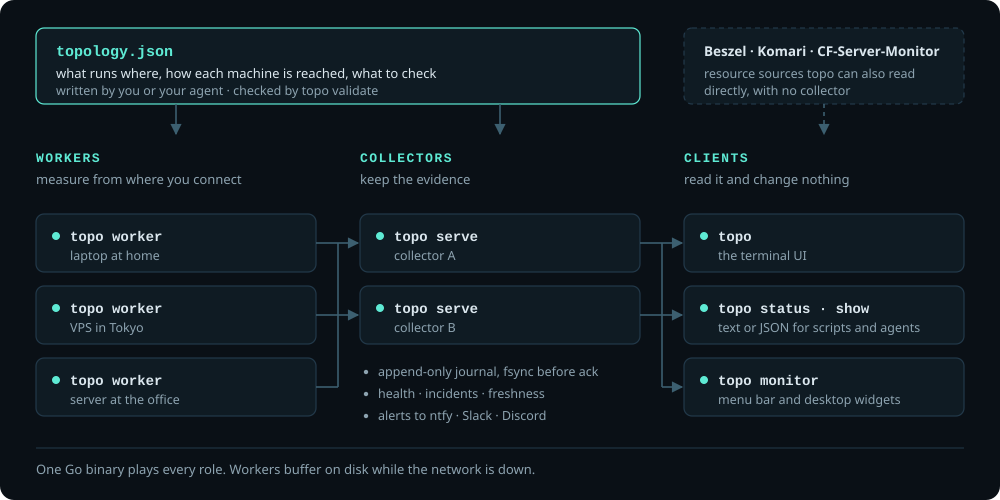
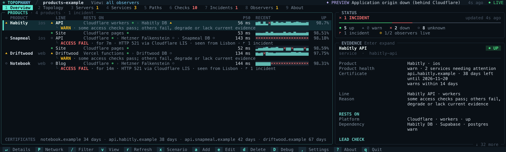

<h1 align="center">
  
</h1>

<p align="center"><b>From where, via which path, reaching what — and on what evidence.</b></p>

<p align="center">
  <a href="https://topophany.com/demo/"></a>
</p>

<p align="center">
  <a href="https://topophany.com"><b>topophany.com</b></a> ·
  <a href="https://github.com/WhitenWhiten/topophany/releases">Download</a> ·
  <a href="docs/GUIDE.md">User guide</a>
</p>

<p align="center"><sub><b>English</b> · <a href="README.ja.md">日本語</a> · <a href="README.zh.md">简体中文</a></sub></p>

<p align="center">
  <a href="https://github.com/WhitenWhiten/topophany/actions/workflows/ci.yml"></a>
  <a href="https://pkg.go.dev/github.com/WhitenWhiten/topophany"></a>
  <a href="LICENSE"></a>
  <a href="https://linux.do"></a>
</p>

**Topophany** puts your network on one screen: your machines and where they are, the paths between them and the services they run. Workers check it from the places you actually connect from, and the terminal UI shows what is broken, seen from where, and the evidence for it. All of it is one self-hosted Go binary, `topo`.

<p align="center">
  
  <br><sub>Press <code>x</code> in <code>topo preview --lang en</code> to break something. Select a problem and its route lights up; <code>Enter</code> shows the evidence.</sub>
</p>

## Features

- **Where it breaks, not just that it broke.** Every check runs from a vantage point you name. Down from Seattle but fine from New York is a fault on Seattle's path, not a server outage.
- **Evidence, not colors.** Health, where the evidence came from and how fresh it is are kept apart. Nothing turns green without a passing check, and a service nobody checks stays `unknown`.
- **Your network in one file.** A reviewed JSON topology says what runs where, how each machine is reached and what to check, with your notes beside it. Your coding agent can write it, and `topo validate` checks it.
- **Checks along the path your traffic takes.** HTTP, TLS, TCP, DNS (with DoT and DoH), SSH, UDP, ICMP and host resources, through proxy chains of several hops. Read-only adapters cover Mihomo, Tailscale, WireGuard, cloudflared, the Cloudflare API, Beszel, Komari and CF-Server-Monitor, and an answer from an edge such as Cloudflare, Vercel or Supabase is never taken for the origin behind it.
- **Made to be looked at.** A braille world map, a schematic map and a network graph, and a card for every server and service, in any terminal, mouse included.
- **Products mode.** For people who ship apps and sites: a row for each part a user reaches, and everything it rests on.
- **Readable by scripts and agents.** `topo status`, `topo show` and `topo history` answer in a line or in JSON, and `topo monitor` feeds menu bars and desktop widgets.
- **One binary, nothing else.** No CGO, no database daemon, no Node.js and zero external Go modules.

<p align="center">
  
  <br><sub>The Overview during a simulated outage, from <code>topo preview --lang en --scenario 1</code>.</sub>
</p>

## Quick start

Download a build from the [releases page](https://github.com/WhitenWhiten/topophany/releases) (Linux, macOS and Windows on amd64 and arm64), or install it with Go 1.26.11 or newer:

```sh
go install github.com/WhitenWhiten/topophany/cmd/topo@latest
```

See the whole UI on synthetic evidence, with nothing to set up, and press `x` to break something:

```sh
topo preview
```

To monitor your own network, follow the [user guide](docs/GUIDE.md) and start from a topology in [`examples/`](examples/). Every configuration field is in the [reference](docs/REFERENCE.md). Upgrading? Read the [1.7.0 release notes](docs/releases/v1.7.0.md).

## How it works

<p align="center">
  
</p>

Workers run the checks and deliver what they see to one or two collectors, which keep an append-only journal and work out health, incidents and freshness. Clients only read: closing the TUI does not stop monitoring, and nothing in Topophany changes routes, proxies or services.

## Products mode

<p align="center">
  
  <br><sub>The server behind Cloudflare has stopped answering, in <code>topo preview --config examples/products.json --mode products --scenario 2</code>.</sub>
</p>

Press `P` and the Overview becomes a board: a row for each part of each product, what it rests on from the edge to the database, its latency, recent samples and uptime, and for a part in trouble, what failed, since when and seen from where. Every mark on it is one the network view already gives. [Products mode guide](docs/PRODUCTS.md)

## The terminal UI

<p align="center">
  
  <br><sub>Down from Seattle, fine from New York: each observer reports only what it can see (<code>v</code>). Then the three maps (<code>m</code>).</sub>
</p>

Nine tabs, from the Overview to the incidents, with services folded into the applications they serve and checks into the services they verify. The [user guide](docs/GUIDE.md) describes every tab, map and key.

## In the macOS menu bar

<p align="center">
  <a href="https://github.com/WhitenWhiten/topophany-bar"></a>
</p>

[**topophany-bar**](https://github.com/WhitenWhiten/topophany-bar) is Topophany's macOS companion: the status in the menu bar, a panel showing where each problem is seen, and desktop widgets for servers, services, maps and time zones. It is in pre-release and needs macOS 26 or later.

## Documentation

| | |
|---|---|
| [User guide](docs/GUIDE.md) · [Chinese guide](docs/GUIDE.zh.md) | Setting up, the TUI, preview mode, probes and multi-location deployment |
| [Configuration and API reference](docs/REFERENCE.md) | Every entity, probe parameter and API endpoint |
| [Products mode](docs/PRODUCTS.md) | The Overview for people who ship apps and sites |
| [Cloudflare](docs/CLOUDFLARE.md) · [Direct mode](docs/DIRECT.md) | From edge to origin; resource sources read without a collector |
| [Operations](docs/OPERATIONS.md) · [Memory](docs/MEMORY.md) | Dual collectors, systemd units, storage, recovery and memory budgets |
| [Security model](docs/SECURITY.md) · [Remote management](docs/MANAGEMENT.md) | Credentials, transport, and opt-in configuration delivery and updates |
| [Scenarios](docs/SCENARIOS.md) · [Acceptance](docs/ACCEPTANCE.md) | What the tests prove, and what needs checking on real hardware |
| [Examples](examples/) | Sample topologies to start from |
| [Changelog](CHANGELOG.md) · [Release notes](docs/releases/) | Release history and upgrade notes |

## Development

```sh
go test ./...                # unit and integration tests
python3 scripts/verify.py    # the full acceptance suite (Linux, Go, Python 3)
make captures architecture   # redraw the README's TUI captures and diagram
```

Read [CONTRIBUTING.md](CONTRIBUTING.md) and the [Code of Conduct](CODE_OF_CONDUCT.md) before sending changes, and report vulnerabilities privately as described in [SECURITY.md](SECURITY.md).

## License

[MIT](LICENSE)
