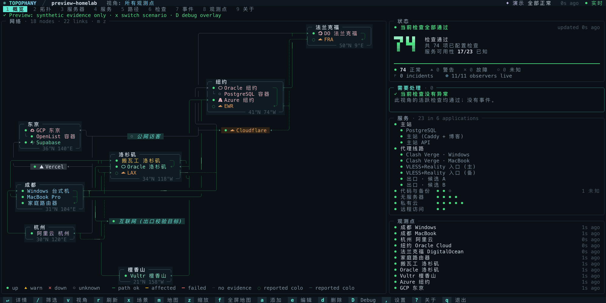
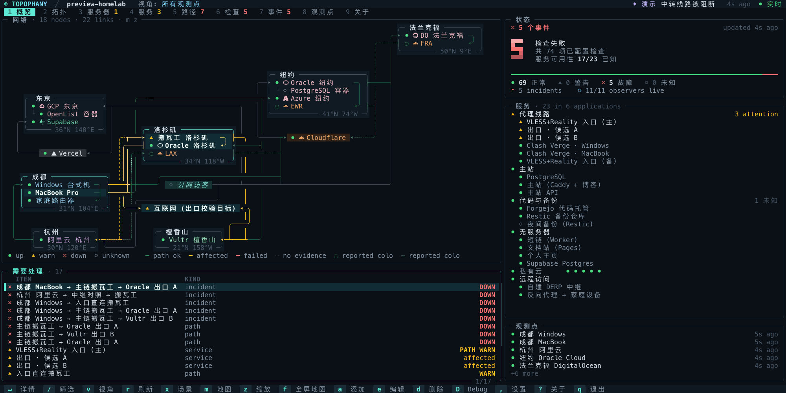
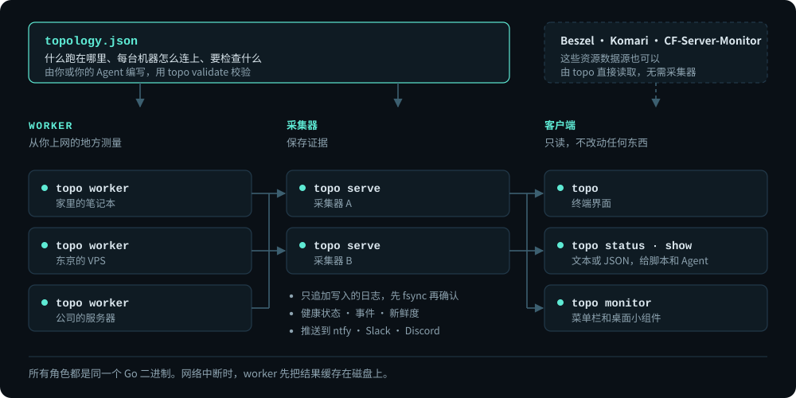
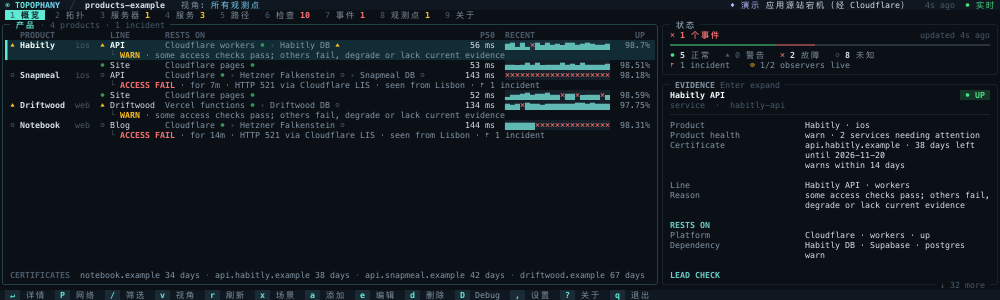
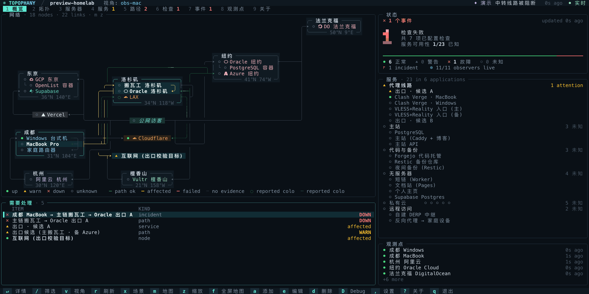

<h1 align="center">
  
</h1>

<p align="center"><b>从哪里出发，经由哪条路径，抵达了什么——依据又是什么。</b></p>

<p align="center">
  <a href="https://topophany.com/zh/demo/"></a>
</p>

<p align="center">
  <a href="https://topophany.com/zh/"><b>topophany.com</b></a> ·
  <a href="https://github.com/WhitenWhiten/topophany/releases">下载</a> ·
  <a href="docs/GUIDE.zh.md">用户指南</a>
</p>

<p align="center"><sub><a href="README.md">English</a> · <a href="README.ja.md">日本語</a> · <b>简体中文</b></sub></p>

<p align="center">
  <a href="https://github.com/WhitenWhiten/topophany/actions/workflows/ci.yml"></a>
  <a href="https://pkg.go.dev/github.com/WhitenWhiten/topophany"></a>
  <a href="LICENSE"></a>
  <a href="https://linux.do"></a>
</p>

**Topophany** 把整张网络摆在一块屏幕上：有哪些机器、各在何处，彼此之间走哪条路，上面跑着哪些服务。worker 从你真正上网的地方发起检查，终端界面告诉你：哪里出了问题，是从哪里看到的，凭什么这么说。这一切都装在一个可以自托管的 Go 二进制文件 `topo` 里。

<p align="center">
  
  <br><sub>在 <code>topo preview --lang zh</code> 里按 <code>x</code> 制造一场故障。选中一个问题，它的路径就会亮起；按 <code>Enter</code> 查看证据。</sub>
</p>

## 核心功能

- **不只知道坏了，还知道坏在哪。** 每项检查都从你命名的观测点发起。从成都不通、从纽约正常，说明出问题的是成都那条路径，而不是服务器宕机。
- **讲证据，不只看颜色。** 健康状态、证据来源和新鲜度分开记录。没有通过的检查就不会变绿，没人检查的服务保持 `unknown`。
- **一个文件写清整张网络。** 一份审阅过的 JSON 拓扑，写明什么跑在哪里、每台机器怎么连上、要检查什么，旁边还有你的笔记。可以交给编程 Agent 来写，再用 `topo validate` 校验。
- **沿着流量真正走的路径检查。** HTTP、TLS、TCP、DNS（含 DoT 和 DoH）、SSH、UDP、ICMP 和主机资源，也可以穿过多跳代理链。只读适配器支持 Mihomo、Tailscale、WireGuard、cloudflared、Cloudflare API、Beszel、Komari 和 CF-Server-Monitor；Cloudflare、Vercel、Supabase 这类边缘的应答，绝不会被当成它背后源站的应答。
- **好看，也耐看。** 盲文点阵的世界地图、示意地图和网络拓扑图，每台服务器、每个服务各一张卡片。任何终端都能跑，也支持鼠标。
- **产品模式。** 为发布 App 和网站的人准备：用户能访问到的每个部分各占一行，连同它所依赖的一切。
- **脚本和 Agent 也能读。** `topo status`、`topo show`、`topo history` 用一行字或 JSON 作答；`topo monitor` 把状态推送给菜单栏和桌面小组件。
- **一个文件，别无依赖。** 不需要 CGO、数据库守护进程或 Node.js，也不依赖任何外部 Go 模块。

<p align="center">
  
  <br><sub>模拟故障时的 Overview，来自 <code>topo preview --lang zh --scenario 1</code>。</sub>
</p>

## 快速开始

从[发布页面](https://github.com/WhitenWhiten/topophany/releases)（Linux、macOS、Windows · amd64、arm64）下载，或者用 Go 1.26.11 及以上版本安装：

```sh
go install github.com/WhitenWhiten/topophany/cmd/topo@latest
```

无需任何配置，就能用模拟数据浏览完整界面；按 `x` 制造一场故障试试：

```sh
topo preview
```

要监控自己的网络，请按[使用指南](docs/GUIDE.zh.md)操作，从 [`examples/`](examples/) 里的拓扑开始。全部配置字段见[参考文档](docs/REFERENCE.md)（英文）。从旧版本升级，请先阅读 [1.7.0 发布说明](docs/releases/v1.7.0.md)（英文）。

## 工作原理

<p align="center">
  
</p>

worker 执行检查，把看到的结果投递给一个或两个采集器；采集器维护一份只追加写入的日志，据此判断健康状态、事件和新鲜度。客户端只读不写：关掉 TUI 不会停止监控，Topophany 也从不修改路由、代理或服务。

## 产品模式

<p align="center">
  
  <br><sub>Cloudflare 后面的服务器停止响应，来自 <code>topo preview --config examples/products.json --mode products --scenario 2</code>。</sub>
</p>

按 `P`，概览就变成一张看板：每个产品的每个部分各占一行，显示它从边缘到数据库依赖哪些层，以及延迟、最近的样本和可用率；出问题的部分还会写明哪里失败、从什么时候开始、从哪里观测到。看板上的每个标记都与网络视图一致。[产品模式指南](docs/PRODUCTS.md)（英文）

## 终端界面

<p align="center">
  
  <br><sub>从成都看已断，从纽约看正常：每个观测点只报告自己看得到的（<code>v</code>）。接着是三种地图（<code>m</code>）。</sub>
</p>

从 Overview 到 Incidents 共九个标签页；服务按所属的应用归类，检查按它所验证的服务归类。[用户指南](docs/GUIDE.md)（英文）介绍了每个标签页、每种地图和每个按键。

## 在 macOS 菜单栏里

<p align="center">
  <a href="https://github.com/WhitenWhiten/topophany-bar"></a>
</p>

[**topophany-bar**](https://github.com/WhitenWhiten/topophany-bar) 是 Topophany 的 macOS 伴侣应用：状态显示在菜单栏，面板告诉你每个问题是从哪里看到的，桌面小组件让服务器、服务、地图和时区一直留在视野里。目前为预发布版，需要 macOS 26 或更高版本。

## 文档

除中文使用指南外，详细文档均为英文。

| | |
|---|---|
| [用户指南（英文）](docs/GUIDE.md) · [中文使用指南](docs/GUIDE.zh.md) | 部署、TUI、预览模式、探针、多地部署 |
| [配置与 API 参考](docs/REFERENCE.md) | 每种实体、探针参数和 API 端点 |
| [产品模式](docs/PRODUCTS.md) | 给发布 App 和网站的人用的概览 |
| [Cloudflare](docs/CLOUDFLARE.md) · [直连模式](docs/DIRECT.md) | 从边缘到源站；不经采集器直接读取的资源数据源 |
| [运维](docs/OPERATIONS.md) · [内存](docs/MEMORY.md) | 双采集器、systemd 单元、存储、恢复和内存预算 |
| [安全模型](docs/SECURITY.md) · [远程管理](docs/MANAGEMENT.md) | 凭据、传输，以及需手动启用的配置下发与升级 |
| [场景](docs/SCENARIOS.md) · [验收](docs/ACCEPTANCE.md) | 测试证明了什么，哪些还需要在真实硬件上验证 |
| [示例](examples/) | 可以直接拿来改的拓扑示例 |
| [变更记录](CHANGELOG.md) · [发布说明](docs/releases/) | 发布历史和升级说明 |

## 开发

```sh
go test ./...                # unit and integration tests
python3 scripts/verify.py    # the full acceptance suite (Linux, Go, Python 3)
make captures architecture   # redraw the README's TUI captures and diagram
```

提交修改前请阅读 [CONTRIBUTING.md](CONTRIBUTING.md) 和[行为准则](CODE_OF_CONDUCT.md)；发现漏洞请按 [SECURITY.md](SECURITY.md) 中的说明私下报告。

## 许可证

[MIT](LICENSE)
